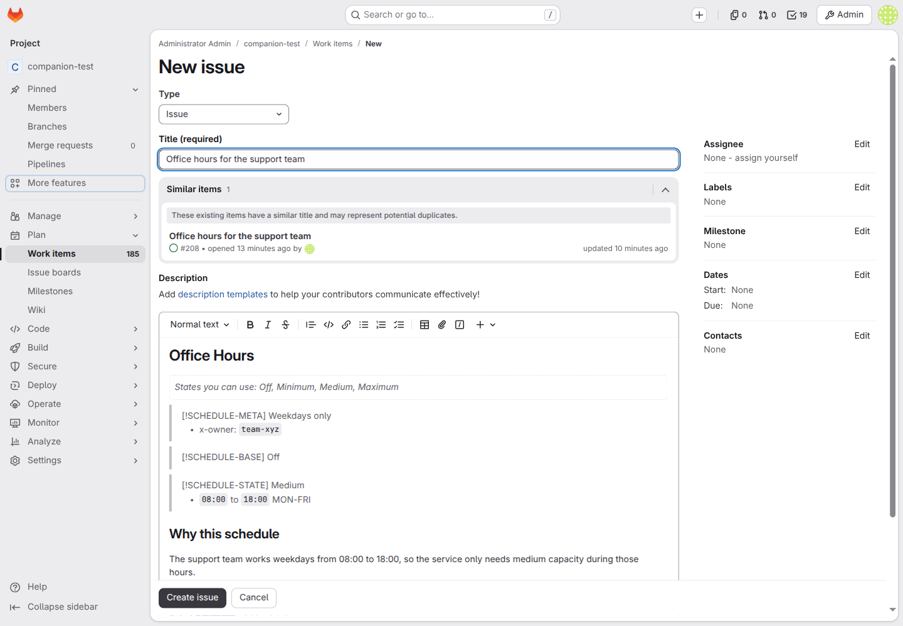
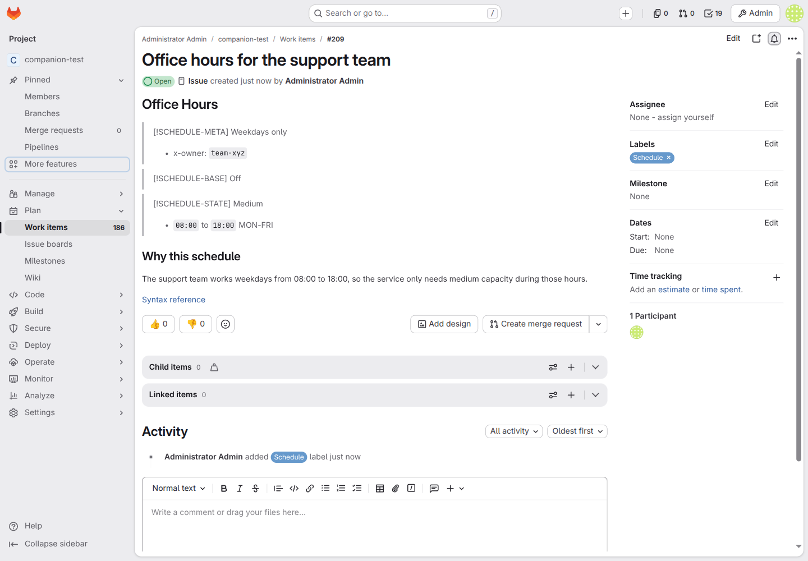
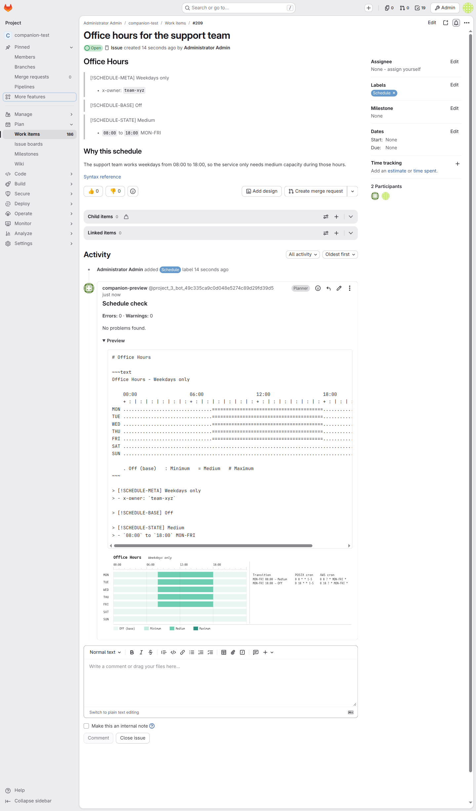
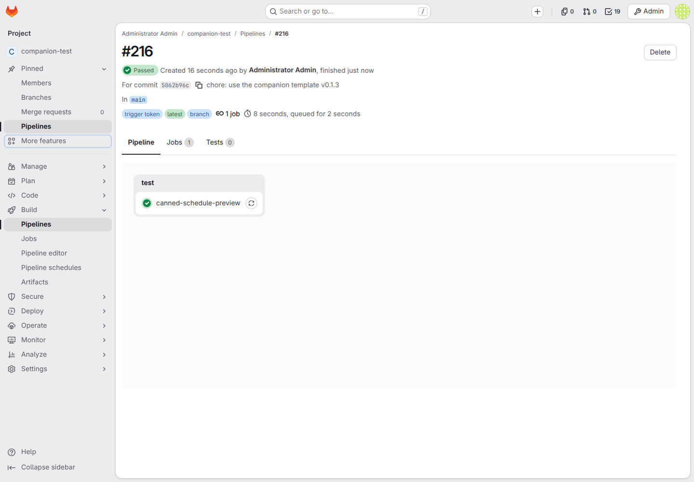
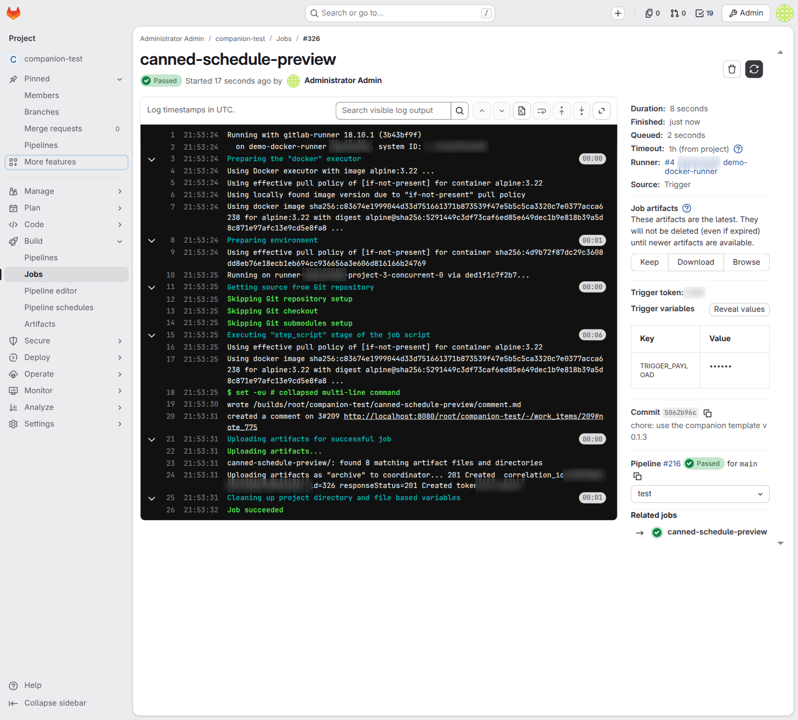
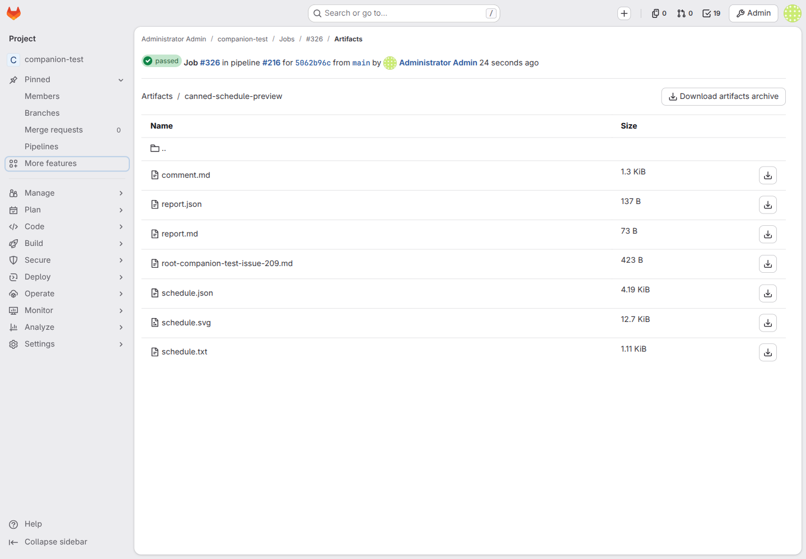
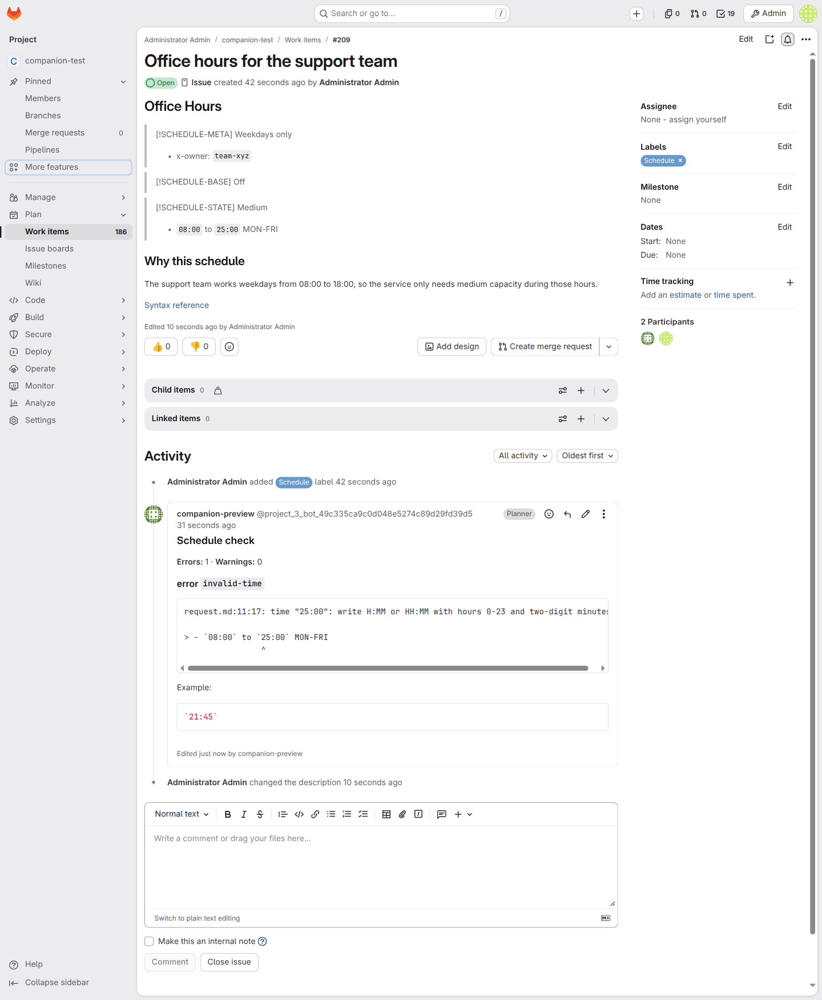
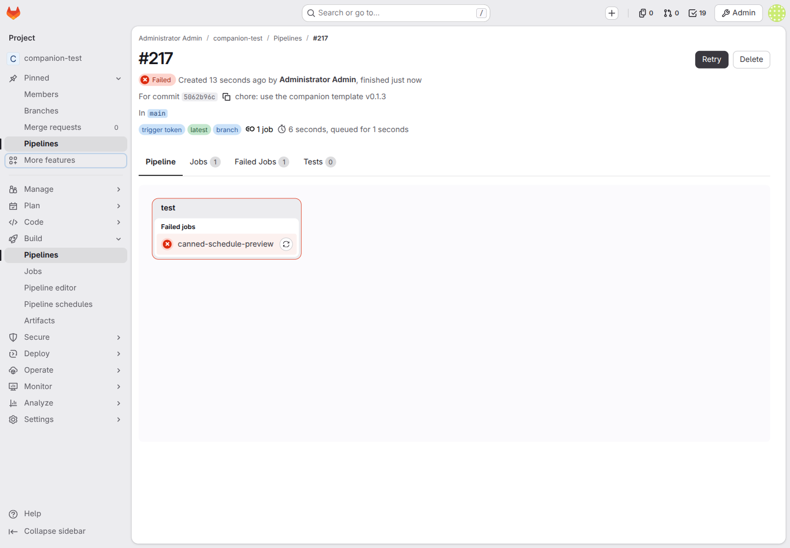

# The GitLab flow in screenshots

What contributors and reviewers see in a project that
[includes the template](../gitlab.md#gitlab-cicd-component). The screenshots show companion `v0.1.3` on a local GitLab.
Runner ids and token prefixes are blurred in the job log.

## 1. Open an issue

The contributor fills in a schedule. The `/label ~Schedule` line at the end of the description adds the label that starts the
check. GitLab lists issues with a similar title above the description.

## 2. The issue exists

The issue has the `Schedule` label, and the webhook has started a pipeline.

## 3. The check answers on the issue

The bot's note has the report, the week as text and the week as a picture with its cron expressions.

## 4. The pipeline

One job, started by the trigger.

## 5. The job

The log names the note it created or updated.

## 6. The files

The job keeps the report, the schedule's outputs and the request as submitted, named after where it came from.

## 7. An edit updates the same note

Changing the description checks the schedule again. Here `18:00` became `25:00`: the note now shows the error with its position
and an example, and there is still only one note.

## 8. A request with errors fails the pipeline

The note reaches the issue first, and the job then fails.

